

# B2B Sipariş & Yönetim Sistemi

**Toptancılar için uçtan uca bayi portalı, saha satış uygulaması ve ERP köprüsü.**

Katalogdan siparişe, sevkiyattan tahsilata, cari defterden yönetici panosuna — tek sistem.

> **Bu depo vitrindir.** Kaynak kod özel depoda tutuluyor; burada ekranlar, mimari ve
> alınan kararlar var. Canlı gösterim ya da kurulum için: [saidbayraktar9@gmail.com](mailto:saidbayraktar9@gmail.com)

Turborepo + pnpm monorepo. Sunucu tarafı Next.js Route Handler'ları (`apps/web` içinde);
aynı uçları Expo mobil uygulaması da kullanıyor. Her müşteri için **ayrı kurulum**
(kiracı klasörü), rol değil **izin** bazlı erişim, para ve stok tarafında **ekle-only defter**.

|                |                                                                     |
| -------------- | ------------------------------------------------------------------- |
| Veri modeli    | 62 Prisma modeli                                                    |
| API            | 165 route handler                                                   |
| Arayüz         | 70 sayfa · 96 arşivlenmiş ekran görüntüsü                           |
| Domain katmanı | 177 dosya (`packages/services`) — fiyatlama, defter, kampanya, rapor |
| Test           | **1.091** (383 web · 690 servis · 18 ERP ajanı) + 137 Playwright testi |
| CI             | `typecheck → lint → test → build`, dördü de yeşil                   |

---

## Ekranlar

Aşağıdaki görüntülerin hepsi betikle üretiliyor, elle alınmıyor:
gerçek veritabanı, gerçek oturum, 1440 px, ölçek 1. Stilsiz yüklenen bir sayfa
kaydedilmiyor — betik onu bir hata sayıyor.

### Giriş — aynı ekran, iki tema

Koyu tema ayrı bir stil sayfası değil: bütün renkler anlamsal token'lardan geliyor,
depodaki ham renk sınıfı sayacı **sıfır** (`documents/**` hariç — kâğıt her zaman beyaz).

<table>
<tr>
<td width="50%">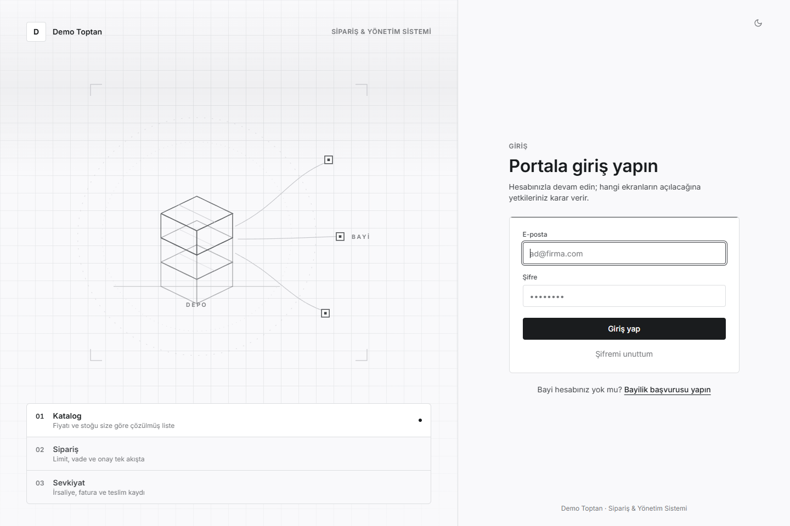</td>
<td width="50%">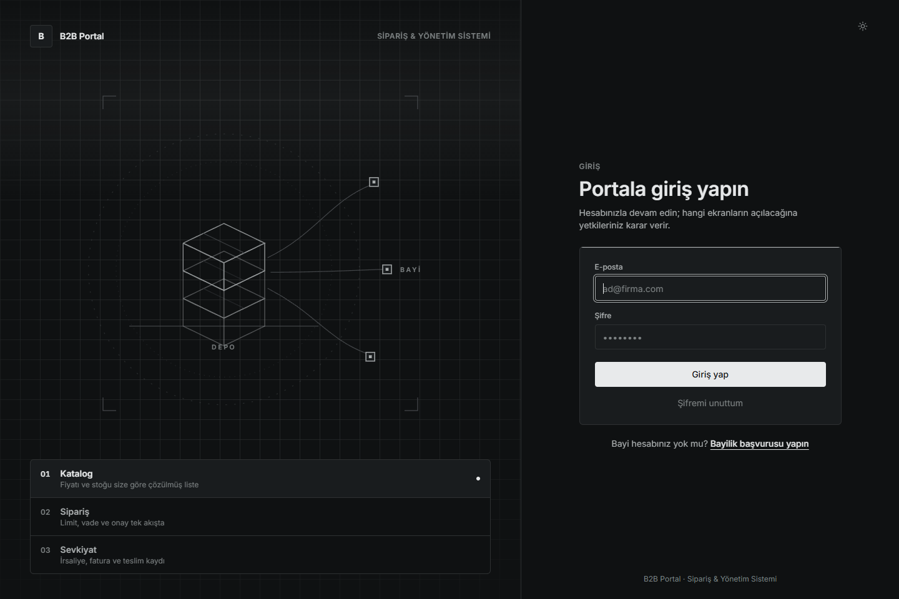</td>
</tr>
</table>

### Yönetim

Sol: yönetici panosu — anlık durum, büyüme, müşteri, ürün & stok, nakit & alacak, gidişat.
Sağ: çek & senet portföyü; kâğıt kasaya **tahsil edilince** giriyor, alındığında değil.

<table>
<tr>
<td width="50%">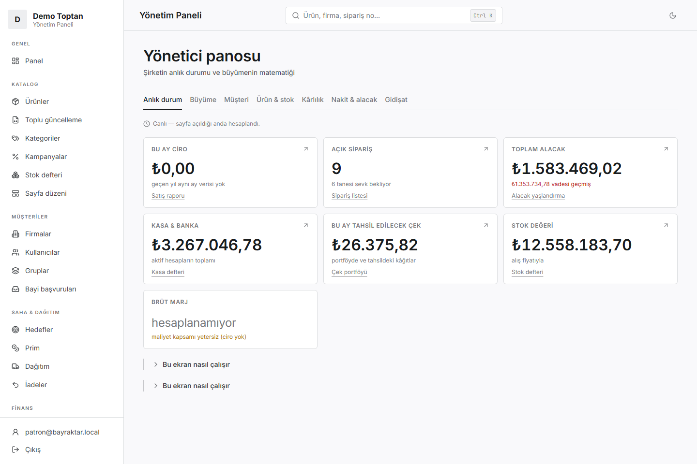</td>
<td width="50%">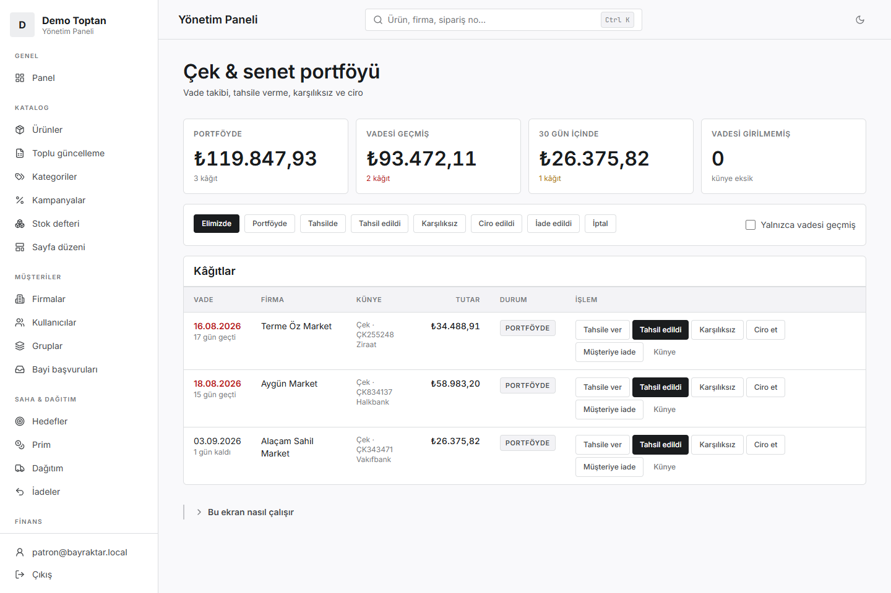</td>
</tr>
</table>

### Saha

Plasiyer paneli hedef, portföy alacağı ve her firmanın yanında üç işi taşıyor:
sipariş · tahsilat · ziyaret. Sağda tahsilat çalışma listesi — "bugün kimi arayacağım".

<table>
<tr>
<td width="50%">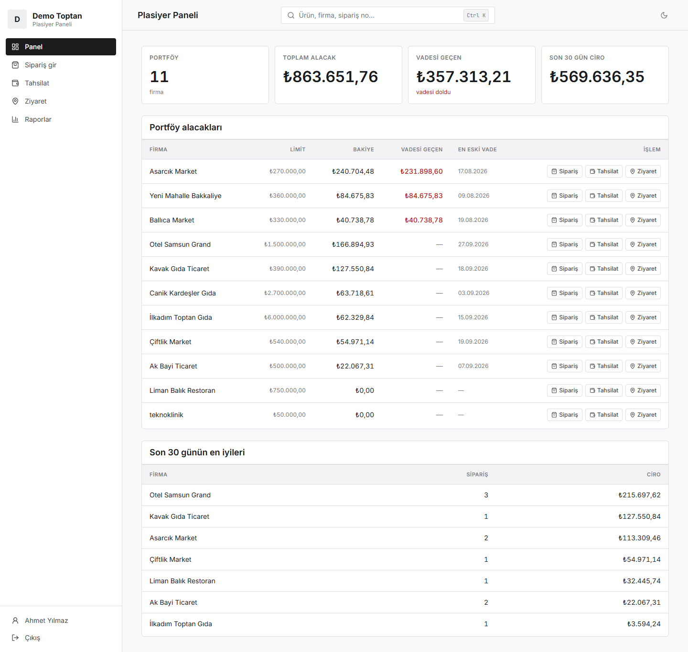</td>
<td width="50%">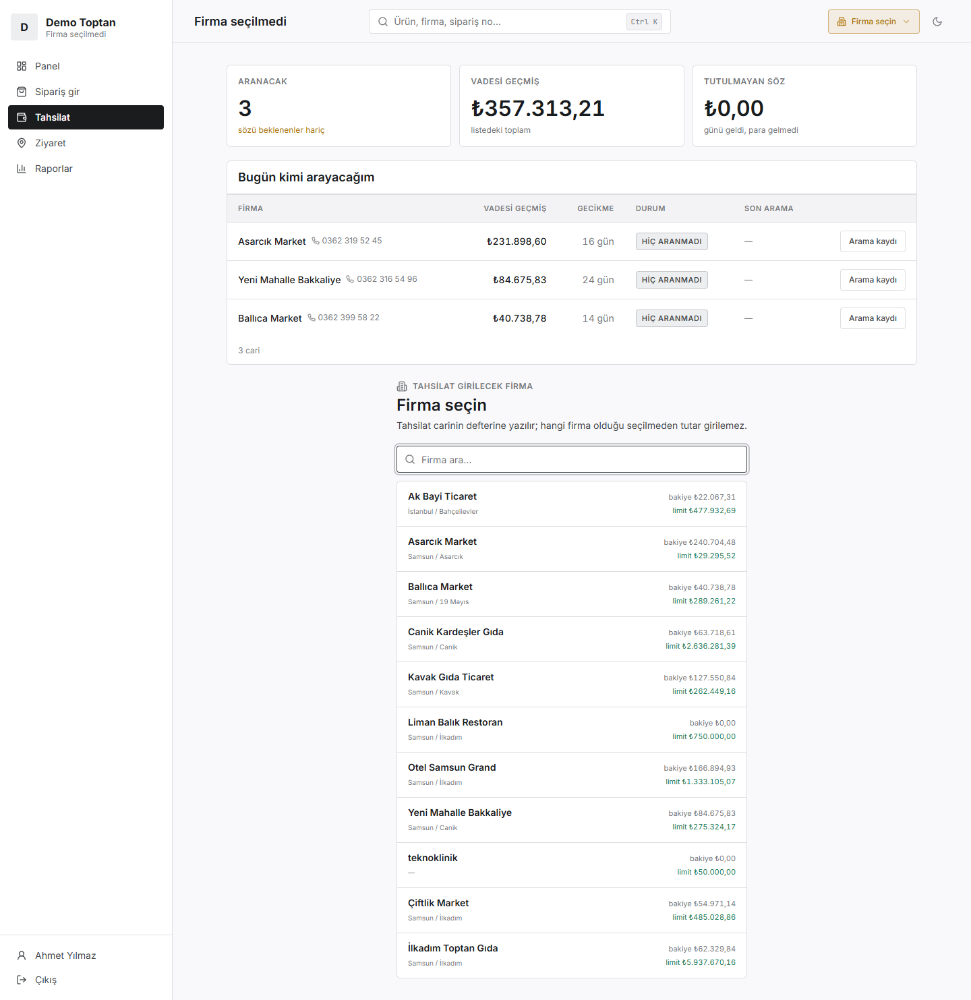</td>
</tr>
</table>

### Bayi portalı

Bayi kendi siparişini, kendi ekstresini ve kendi kullanıcılarını görüyor.
Kayıt hesap açmıyor: **bayilik başvurusu** oluyor, onaylanınca firma kartı ve yönetici hesabı doğuyor.

<table>
<tr>
<td width="50%">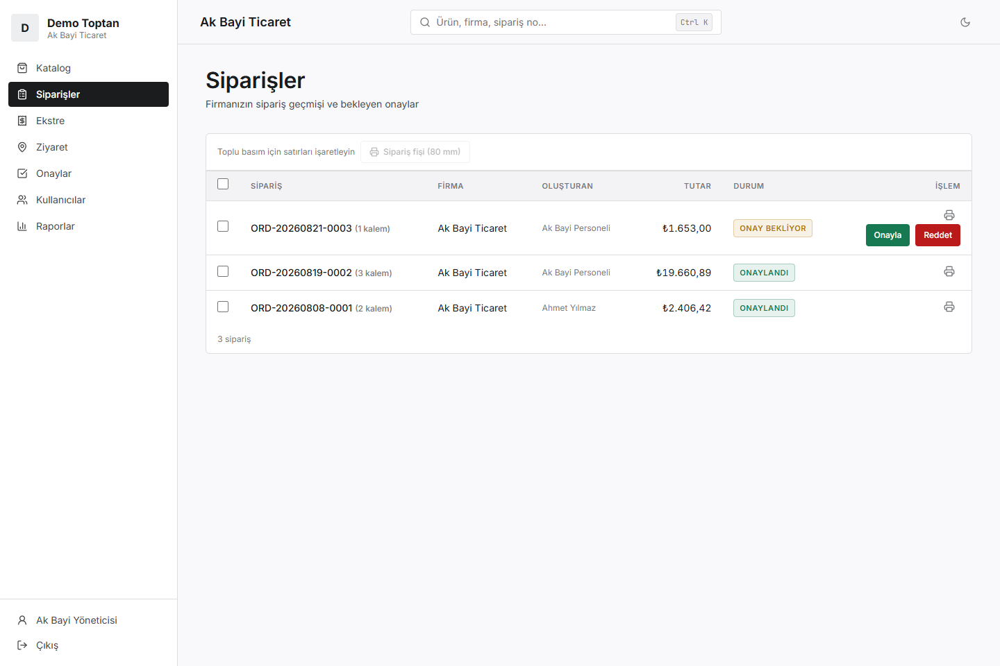</td>
<td width="50%">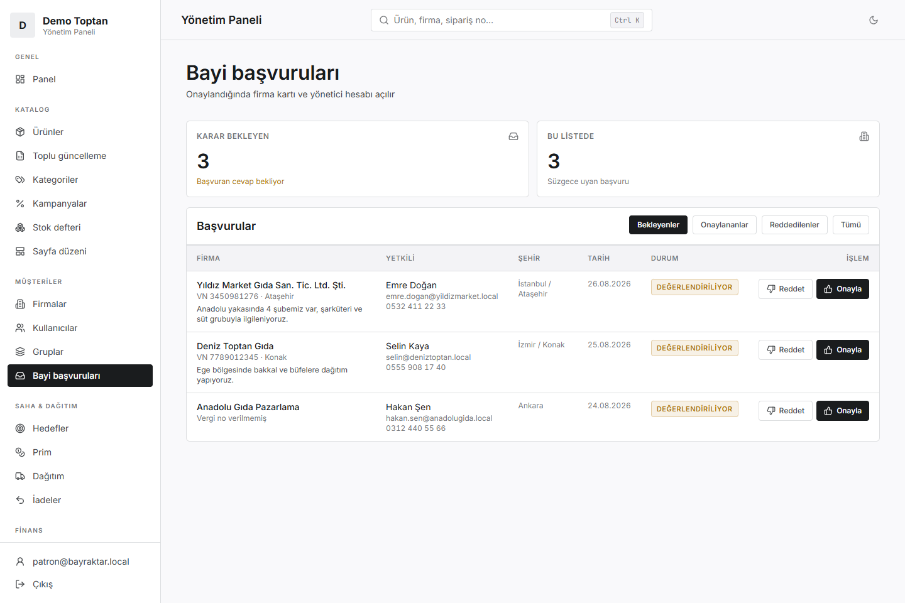</td>
</tr>
</table>

### Cari ve kampanya

Cari ekstre yaşlandırmayla birlikte; CSV ve yazdırma yüzeyi var.
Kampanya karnesinde **"kampanyanın getirdiği ciro" kolonu bilerek yok** — artımlı etki
kontrol grubu ister; onun yerine aynı aralıktaki kampanyasız siparişlerin ortalama sepeti duruyor.

<table>
<tr>
<td width="50%">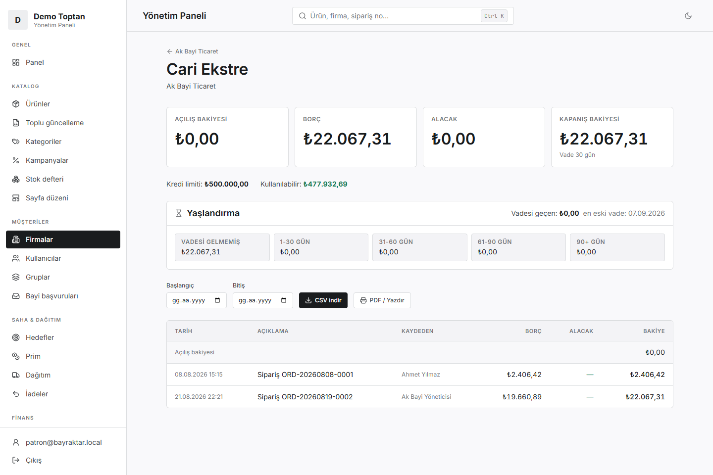</td>
<td width="50%">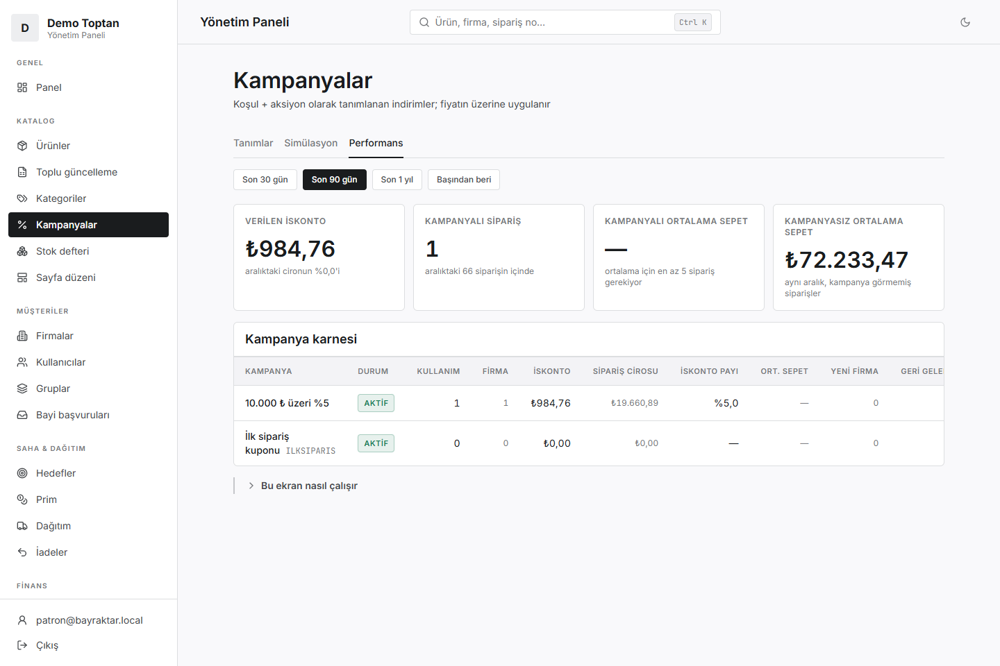</td>
</tr>
</table>

### Rapor tasarımcısı ve belgeler

Rapor **veri**, kod değil: veri kümesi seç, sütun ekle, filtrele, grupla, kaydet, paylaş.
Alan adı istemciden gelmiyor — kayıt defteri güvenlik sınırı, ve kaydedilmiş bir rapor
çağıranın kapsamını genişletemiyor. Sağda irsaliye; satıcı bloğu kiracı klasöründen geliyor.

<table>
<tr>
<td width="50%">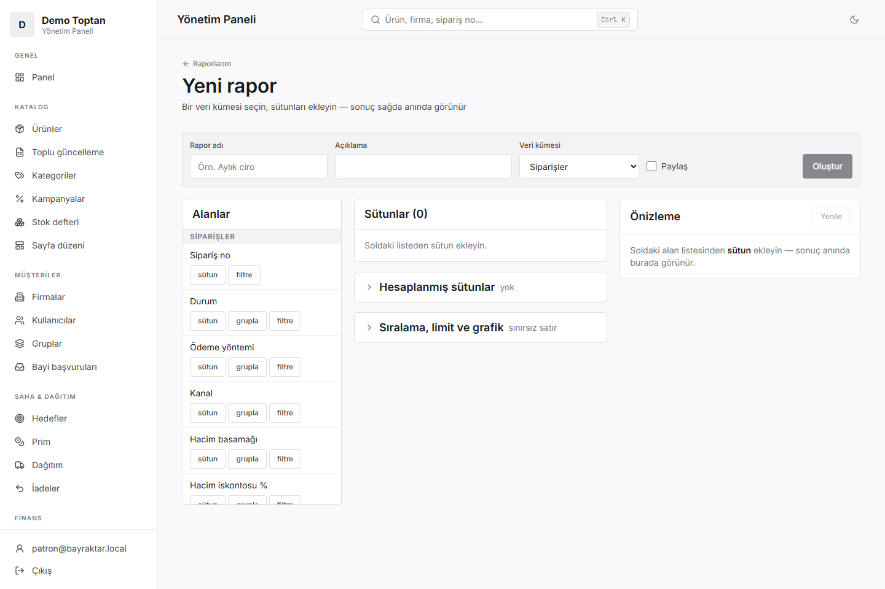</td>
<td width="50%">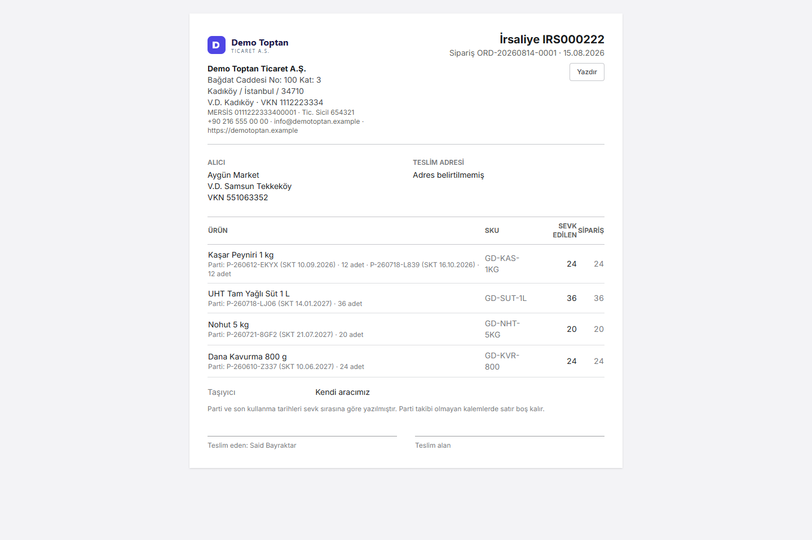</td>
</tr>
</table>

---

## Öne çıkan kararlar

- **İzin, rol değil.** 29 adlandırılmış izin; süper admin için bypass yok, kimse kendinde
  olmayan izni veremiyor. Tek kapı: `requireUser` / `requirePage`.
- **Para ve stok ekle-only defterde.** İptal, satırı silmiyor — **ters kayıt** yazıyor.
  Stok tek kapıdan hareket ediyor; ERP farkı da defterde bir satır.
- **Fiyat tek yerde çözülüyor.** Liste fiyatı → cari iskontosu → hacim kademesi → kampanya
  sırası sunucuda; sepet istemcinin gönderdiği tutara bakmıyor.
- **Az veriyle yalan söylenmiyor.** Panodaki her göstergenin asgari veri şartı kodda
  (trend 6 ay, CAGR 24 ay, RFM 8 firma); karşılanmıyorsa sayı yerine eksiğin kendisi yazılıyor.
  Marj, cironun en az %60'ının maliyeti girilmiş üründen gelmesi şartına bağlı.
- **Her müşteri ayrı kurulum.** `tenantId` yok; kiracı kimliği dosyadan geliyor
  (`tenants/<slug>/tenant.json`) ve yapılandırma bozuksa belge geçersiz işaretleniyor.
- **Ekran görüntüsü regresyon kontrolü.** Her biten ekranın görüntüsü depoda; son turda
  testlerin hiçbirinin görmediği üç hatayı bu adım yakaladı.

## Son eklenenler

- **Banka sanal POS kapıları** — İş Bankası, Halkbank, TEB, Şekerbank, Ziraat, QNB, Akbank (NestPay),
  QNB PayFor, Denizbank InterVPOS. Yalnız bankanın barındırılan ödeme sayfası: kart verisi sisteme hiç girmez.
- **Kesirli miktar, çoklu birim (koli/palet), depo bazlı stok.**
- **Modül aç/kapa, basit/gelişmiş görünüm, özel kodlar.**
- **Masaüstü kabuğu ve mobil APK** — ikisi de merkezden kendini güncelliyor.

## Kaynak kod ve lisans

Kaynak kod **tescillidir — tüm hakları saklıdır**. Bu depodaki metin ve görseller
çalışmayı tanıtmak için yayımlanmıştır; kopyalama, yeniden dağıtma ya da satış
için lisans verilmez. Ayrıntı: [LICENSE](LICENSE).

---

Said Bayraktar · Bayraktar Yazılım · Samsun · [LinkedIn](https://www.linkedin.com/in/said-bayraktar9)
